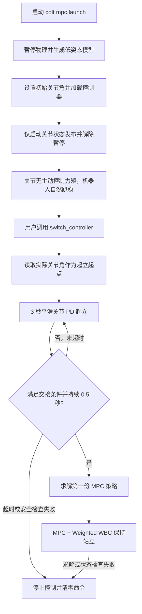

# Colt 起立、trot 前进与 20 N·m 力矩保护：工作及问题记录

> 第 1–8 节保留 2026-10-28 起立阶段的历史实现、调试过程和验证数据，其中 3 秒起立、30 N·m 等数值不是当前配置。第 9–12 节记录 2026-10-29 的 trot 前进、20 N·m 保护、遇到的问题及最新验收结果。操作指令统一见 [README.md](README.md)。

当前完整流程是“自然趴下 → 手动命令起立 → MPC + WBC 保持站立 → trot 前进 → 减速并恢复四足站立”。

| 项目 | 当前 Colt 配置 |
|---|---|
| 起立 | 5 秒平滑关节 PD，Kp=40、Kd=1.5；交接条件持续满足 0.5 秒后启用 MPC/WBC |
| 站立目标 | 基座原点高度 0.284 m，每条腿关节角 `[0, 0.72, -1.44] rad` |
| trot | 两组对角腿交替支撑，周期 0.6 秒，每个相位 0.3 秒 |
| 前进脚本 | 默认 0.08 m/s，匀速段 10 秒，加减速各 2 秒，完成后返回 stance |
| 最终执行力矩 | 12 个关节均硬限制为 ±20 N·m，覆盖起立、站立、行走和停车 |

控制仍分为两个阶段：**关节 PD 完成起立过渡，MPC + WBC 完成起立后的站立与 trot 控制**。
`/controller_manager/switch_controller` 是 legged_control 原来使用的控制器启动入口；从趴姿平滑起立的逻辑是本次为 Colt 新增的，不能把这个服务本身理解成原项目已经具备的趴姿恢复算法。
Colt 的实际参数来自 `task.info`，会覆盖控制器头文件中的缺省值；阅读历史代码摘录时应与当前配置区分。

## 1. 原来为什么不能直接从趴下起立

最初的 Colt 包主要用于显示 SolidWorks 导出的模型，缺少连接 legged_control 所需的 transmission、Gazebo 控制插件、传感器对应和专用控制配置。
完成模型接入后，早期启动方式是直接以接近站立的姿态生成机器人，再启动 MPC/WBC，这只能证明站立控制链路能够运行。

原控制器的 `starting()` 会立即根据当前状态求解第一份 MPC 策略。机器人趴在地面时，机身或腿部可能与地面接触，足端也未必形成正常支撑；现有 MPC/WBC 主要描述足端接触，没有完整描述机身贴地、起身时接触变化的过程。因此，不能只切换控制器后就假定 MPC 会自动完成趴姿恢复。

本次增加显式起立过渡，等机器人接近正常站姿后，再让现有的 MPC/WBC 接管。

## 2. 完整执行流程



### 2.1 低姿态生成与自然趴下

入口是 [src/colt/launch/mpc.launch](src/colt/launch/mpc.launch)，实际初始化工作由 [src/colt/scripts/bringup.py](src/colt/scripts/bringup.py) 完成。

脚本在物理暂停时完成以下工作：

1. 从 `robot_description` 生成 Colt 模型。
2. 根据 `initial_pose.yaml` 设置一次初始关节角。
3. 加载关节状态控制器和所选 legged 控制器，此时尚未执行起立控制。
4. 默认只启动 `joint_state_controller`，然后解除物理暂停。

生成姿态为基座原点高度 `0.08 m`、每条腿 `[HAA, HFE, KFE] = [0, 1.4, -2.6] rad`。
解除暂停后，legged 控制器没有启动，关节不施加主动控制力矩，机器人在重力和碰撞作用下自然落稳。实测落稳后基座原点高度约为 `0.002 m`，该值不是机身顶面的高度。

`SpawnModel` 和 `SetModelConfiguration` 只用于创建初始场景。收到起立命令后，不再调用设置模型位姿的服务把机器人抬起来，起立依靠关节力矩和地面反作用力完成。

### 2.2 手动命令触发控制器

真值估计模式的起立入口：

```bash
rosservice call /controller_manager/switch_controller "start_controllers: ['controllers/legged_cheater_controller']
stop_controllers: []
strictness: 2
start_asap: true
timeout: 5.0"
```

Kalman 模式将启动名称换为 `controllers/legged_controller`。
两者使用同一段起立控制和 MPC/WBC 代码，区别在状态估计来源。

控制器刚加载时通常显示 `initialized`；收到启动请求后，controller_manager 调用它的 `starting()`，进入起立过渡，随后持续调用 `update()`。
服务返回 `ok: True` 表示启动请求成功，不表示机器人已经站起来。

### 2.3 从实际姿态平滑运动到站姿

核心代码位于 [LeggedController.cpp](src/legged_control/legged_controllers/src/LeggedController.cpp) 的 `starting()` 和新增的 `updateStandup()`。

`starting()` 不把 YAML 中的生成角度当作起立起点，而是重新读取当前传感器状态，记录实际关节角 `q_start`。因为无动力落稳后，实际关节角已经与生成角度不同。

起立目标 `q_target` 来自 Colt 的 `reference.info/defaultJointState`，每条腿为 `[0, 0.72, -1.44] rad`。
默认过渡时间 `T = 3 s`，使用三次平滑插值：

```text
s = clamp(elapsed / T, 0, 1)
b = 3s² − 2s³
q_des  = q_start + b × (q_target − q_start)
dq_des = 6s(1−s) / T × (q_target − q_start)
```

这使目标位置连续，且插值起点和终点的目标速度均为零；它不是加速度、冲击或接触力都连续的保证。

随后通过混合关节接口发送：

```cpp
hybridJointHandles_[j].setCommand(
    desired(j), rate * displacement(j), standupKp_, standupKd_, 0.0);
```

Gazebo 执行接口将其转换成关节力矩：

```text
τ = Kp × (q_des − q) + Kd × (dq_des − dq) + τ_ff
```

起立阶段默认 `Kp = 60`、`Kd = 3`、`τ_ff = 0`，此时尚未使用 WBC 力矩。
执行端受 URDF effort 上限约束；`task.info/torqueLimitsTask` 是 WBC 阶段的优化约束，不能把它误认为起立 PD 自己实现的限幅。

### 2.4 判断何时可以交接给 MPC

`updateStandup()` 同时检查：

| 条件 | 当前代码要求 |
|---|---|
| 插值时间 | 已运行至少 `standup.duration`，默认 3 秒 |
| 关节误差 | 所有关节绝对误差的最大值 `< 0.15 rad` |
| 基座估计高度 | `currentObservation_.state(8) > 0.24 m` |
| 俯仰与侧倾 | 各自绝对值 `< 0.25 rad` |
| 条件持续时间 | 上述条件连续满足至少 `0.5 s` |

如果条件中断，持续计时重新开始。超过 `standup.duration + 5 s` 仍不能交接时抛出异常，默认相当于约 8 秒超时。

这些是当前实现的交接判据，并不是完整的稳定性证明；这里没有额外要求四足接触模式必须为 15，也没有设置关节速度收敛阈值。

### 2.5 初始化 MPC，再由 WBC 执行站立控制

新增的 `initializePolicy()` 将原本放在 `starting()` 中的首份 MPC 策略求解提取出来，允许在起立完成后再调用。

它以实际状态作为参考轨迹起点，构造 1 秒后的站立目标：

- 基座高度取 `reference.info/comHeight`，当前为 `0.284 m`。
- 俯仰、侧倾目标设为 0，平面位置和偏航沿用当前值。
- 关节目标取 `defaultJointState`，归一化质心动量目标设为 0。

之后设置当前观测与目标轨迹，同步调用 `advanceMpc()` 求解首份策略。收到初始策略后，才设置 `mpcRunning_ = true`，允许后台 MPC 线程周期求解。

后续 `update()` 恢复原有控制链：

```text
状态估计
  → MPC 更新和策略评估
  → 得到期望状态、接触力及关节速度
  → Weighted WBC 求解关节力矩
  → HybridJointInterface
  → LeggedHWSim
  → Gazebo 关节
```

站立阶段的关节命令仍沿用原控制器方式：位置反馈增益为 0、速度反馈增益为 3，前馈力矩由 WBC 给出。因此，“起立 PD”和“站立 MPC/WBC”是两个有明确交接点的阶段。

## 3. 为起立流程新增或修改的主要代码

下表中的“新增”指本次项目适配过程中创建；“修改”指在原有文件上扩展。

| 文件 | 类型 | 具体用途 |
|---|---|---|
| [src/colt/launch/mpc.launch](src/colt/launch/mpc.launch) | 新增，后续调整 | 统一加载 Colt 模型、配置和启动脚本；默认 `start_control=false`，等待手动命令 |
| [src/colt/scripts/bringup.py](src/colt/scripts/bringup.py) | 新增，后续调整 | 暂停时生成模型、设置生成姿态、加载控制器；默认只启用关节状态发布并解除暂停 |
| [src/colt/config/initial_pose.yaml](src/colt/config/initial_pose.yaml) | 新增，后续调整 | 将生成姿态与站立目标分开：低姿态生成，允许自然趴下 |
| [LeggedController.h](src/legged_control/legged_controllers/include/legged_controllers/LeggedController.h) | 修改 | 增加起立参数、起点/目标关节向量、计时变量、`standingUp_` 标志及两个辅助函数声明 |
| [LeggedController.cpp](src/legged_control/legged_controllers/src/LeggedController.cpp) | 修改 | 读取起立配置；`starting()` 进入 PD 阶段；`updateStandup()` 插值与交接判断；`initializePolicy()` 延迟启动 MPC；`update()` 按阶段分支 |
| [Colt task.info](src/legged_control/legged_controllers/config/colt/task.info) | 新增，后续扩展 | 启用 Colt 起立逻辑，设置时间和 PD 增益，并保留 MPC/WBC 的站姿参数 |
| [Colt reference.info](src/legged_control/legged_controllers/config/colt/reference.info) | 新增 | 提供默认站立关节角和基座高度，供起立目标及 MPC 参考共同使用 |
| [LeggedHWSim.h](src/legged_control/legged_gazebo/include/legged_gazebo/LeggedHWSim.h) | 修改 | 增加 `firstRead_`，区分首次反馈读取 |
| [LeggedHWSim.cpp](src/legged_control/legged_gazebo/src/LeggedHWSim.cpp) | 修改 | 修复深弯曲时的关节角度分支；首次读取不产生虚假速度；保留连续关节的累积角处理 |
| [README.md](README.md) | 修改 | 给出自然趴下、手动起立、两种估计器验收和退出的完整指令 |

### 3.1 起立参数与逻辑标志

Colt 的 `task.info` 中新增：

```text
standup
{
  enabled true
  duration 3.0
  kp 60.0
  kd 3.0
}
```

代码用 `standupEnabled_` 表示该机器人是否启用起立扩展，`standingUp_` 表示当前是否处于起立阶段，`mpcRunning_` 控制后台 MPC 是否运行。
没有配置 `standup.enabled` 的其他机器人默认不启用此扩展，仍走原来的直接初始化 MPC 流程。

### 3.2 为什么启动脚本使用线程切换控制器

Gazebo 的控制器切换需要在物理更新中执行。如果物理仍暂停，脚本先同步等待切换返回、再解除暂停，就可能相互等待。

因此 `bringup.py` 用一个线程发起切换请求，主线程随后解除暂停，再等待切换结果。默认请求只启动关节状态控制器；显式设置 `start_control=true` 时，也可自动触发同一段起立流程。
用户手动调用起立服务时，物理已经运行，不需要自行处理这个线程配合过程。

### 3.3 代码摘录的阅读方式

以下代码从当前工作空间的源文件摘录，说明新增逻辑实际写在哪里。完整新文件直接展示；原有大文件展示相关函数或局部代码，不重复粘贴未改动的 MPC/WBC 全部实现。
局部片段依赖原类成员、头文件和上下文，不应单独粘贴成一个可编译文件。后续修改程序时，以链接的源文件为准，并同步更新本文片段。

### 3.4 新增启动入口 `mpc.launch`

文件：[src/colt/launch/mpc.launch](src/colt/launch/mpc.launch)。当前完整内容如下：

```xml
<launch>
  <arg name="gui" default="true"/>
  <arg name="cheater" default="true" doc="Use Gazebo ground truth for initial MPC/WBC validation"/>
  <arg name="start_control" default="false" doc="Start stand-up automatically; otherwise wait for switch_controller"/>
  <include file="$(find colt)/launch/gazebo.launch">
    <arg name="gui" value="$(arg gui)"/>
    <arg name="paused" value="true"/>
    <arg name="spawn" value="false"/>
  </include>
  <param name="urdfFile" value="$(find colt)/urdf/colt.urdf"/>
  <param name="taskFile" value="$(find legged_controllers)/config/colt/task.info"/>
  <param name="referenceFile" value="$(find legged_controllers)/config/colt/reference.info"/>
  <param name="gaitCommandFile" value="$(find legged_controllers)/config/colt/gait.info"/>
  <rosparam command="load" file="$(find legged_controllers)/config/controllers.yaml"/>
  <node name="colt_bringup" pkg="colt" type="bringup.py" output="screen">
    <rosparam command="load" file="$(find colt)/config/initial_pose.yaml"/>
    <param name="cheater" value="$(arg cheater)"/>
    <param name="start_control" value="$(arg start_control)"/>
  </node>
  <node name="legged_robot_target" pkg="legged_controllers" type="legged_target_trajectories_publisher" output="screen"/>
</launch>
```
`start_control=false` 决定默认等待手动起立；`paused=true` 使加载过程不受重力下落影响；`spawn=false` 避免 launch 和 Python 脚本重复生成同一个模型。
`urdfFile` 直接指向 Colt 的 URDF，其他三个路径分别指定控制任务、站姿参考和步态配置。

### 3.5 新增初始化脚本 `bringup.py`

文件：[src/colt/scripts/bringup.py](src/colt/scripts/bringup.py)。当前完整内容如下：

```python
#!/usr/bin/env python3
"""Spawn in crouch, load controllers, unpause and wait for a manual start."""
import threading
import time

import rospy
from controller_manager_msgs.srv import LoadController, SwitchController, SwitchControllerRequest
from gazebo_msgs.srv import GetPhysicsProperties, SetModelConfiguration, SpawnModel
from geometry_msgs.msg import Pose
from nav_msgs.msg import Odometry
from std_srvs.srv import Empty


def service(name, service_type):
    rospy.wait_for_service(name, timeout=120.0)
    return rospy.ServiceProxy(name, service_type)


def main():
    rospy.init_node("colt_bringup")
    physics = service("/gazebo/get_physics_properties", GetPhysicsProperties)()
    if not physics.success or not physics.pause:
        raise RuntimeError("Colt bringup requires Gazebo physics to be paused")
    pose = Pose()
    pose.position.z = rospy.get_param("~base_height")
    pose.orientation.w = 1.0
    result = service("/gazebo/spawn_urdf_model", SpawnModel)(
        "colt", rospy.get_param("/robot_description"), "/", pose, "world")
    if not result.success:
        raise RuntimeError(result.status_message)
    result = service("/gazebo/set_model_configuration", SetModelConfiguration)(
        "colt", "robot_description", rospy.get_param("~joint_names"), rospy.get_param("~joint_positions"))
    if not result.success:
        raise RuntimeError(result.status_message)

    # Gazebo's p3d plugin does not publish while paused. Seed the known initial
    # pose so the cheater estimator has valid data on its first control update.
    initial_odom = Odometry()
    initial_odom.header.frame_id = "world"
    initial_odom.child_frame_id = "base"
    initial_odom.pose.pose = pose
    seed_publisher = rospy.Publisher("/ground_truth/state", Odometry, queue_size=1, latch=True)
    seed_publisher.publish(initial_odom)

    controller = "controllers/legged_cheater_controller" if rospy.get_param("~cheater") else "controllers/legged_controller"
    load = service("/controller_manager/load_controller", LoadController)
    for name in ("controllers/joint_state_controller", controller):
        rospy.loginfo("Loading %s (CppAD compilation may take several minutes)", name)
        if not load(name).ok:
            raise RuntimeError("Failed to load " + name)
    switch = service("/controller_manager/switch_controller", SwitchController)
    unpause = service("/gazebo/unpause_physics", Empty)
    request = SwitchControllerRequest()
    request.start_controllers = ["controllers/joint_state_controller"]
    if rospy.get_param("~start_control"):
        request.start_controllers.append(controller)
    request.strictness = SwitchControllerRequest.STRICT
    # Switching is applied on the next physics update; another thread unpauses.
    result_holder = {}

    def activate():
        try:
            result_holder["response"] = switch(request)
        except Exception as error:
            result_holder["error"] = error

    worker = threading.Thread(target=activate, daemon=True)
    worker.start()
    time.sleep(0.1)  # Wall time: ROS simulation time is paused.
    unpause()
    worker.join(timeout=300.0)
    response = result_holder.get("response")
    if worker.is_alive() or response is None or not response.ok:
        service("/gazebo/pause_physics", Empty)()
        raise RuntimeError("Controller activation failed or timed out: " + str(result_holder.get("error", "no successful response")))
    if rospy.get_param("~start_control"):
        rospy.loginfo("Colt stand-up requested with %s; wait for MPC/WBC handover", controller)
    else:
        rospy.loginfo("Colt ready and unpowered; start %s via /controller_manager/switch_controller to stand up", controller)


if __name__ == "__main__":
    try:
        main()
    except (rospy.ROSException, rospy.ServiceException, RuntimeError) as error:
        rospy.logfatal("Colt bringup failed: %s", error)
        raise SystemExit(1)
```
这段代码有四个要点：

- 模型及初始关节只在启动时设置一次，后续起立不调用 Gazebo 位姿设置服务。
- 暂停期间发布的锁存里程计来自已知生成姿态，用于初始化真值估计器。
- 默认切换请求只包含关节状态控制器，legged 控制器保持未启动状态。
- 切换请求放到线程中，主线程解除暂停，让 controller_manager 能在物理更新中完成切换；切换失败则暂停物理并报错。

### 3.6 生成姿态与站立目标分开配置

文件：[initial_pose.yaml](src/colt/config/initial_pose.yaml)。当前完整内容如下：

```yaml
# Unpowered crouch at spawn; gravity then lets the robot settle naturally.
# This differs intentionally from reference.info, which defines the STANDING target.
base_height: 0.08
joint_names: [LF_HAA, LF_HFE, LF_KFE, LH_HAA, LH_HFE, LH_KFE, RF_HAA, RF_HFE, RF_KFE, RH_HAA, RH_HFE, RH_KFE]
joint_positions: [0.0, 1.4, -2.6, 0.0, 1.4, -2.6, 0.0, 1.4, -2.6, 0.0, 1.4, -2.6]
```
站立目标仍来自 `reference.info`：每条腿 `[0, 0.72, -1.44] rad`，基座目标高度 `0.284 m`。
两份配置的数值不同是有意设计：前者决定自然落稳前如何生成模型，后者决定控制器最终要达到的站姿。

### 3.7 控制器新增成员与参数读取

文件：[LeggedController.h](src/legged_control/legged_controllers/include/legged_controllers/LeggedController.h)，私有成员新增部分：

```cpp
  void initializePolicy();
  bool updateStandup(const ros::Time& time);
  bool standupEnabled_ = false;
  bool standingUp_ = false;
  scalar_t standupDuration_ = 3.0, standupKp_ = 60.0, standupKd_ = 3.0;
  scalar_t standupHeight_ = 0.284;
  ros::Time standupStartTime_, standupReadySince_;
  vector_t standupStartPosition_, standupTargetPosition_;
```
`LeggedController.cpp::init()` 中增加以下读取逻辑（节选）：

```cpp
  boost::property_tree::ptree settings;
  boost::property_tree::read_info(taskFile, settings);
  standupEnabled_ = settings.get<bool>("standup.enabled", false);
  standupDuration_ = settings.get<scalar_t>("standup.duration", 3.0);
  standupKp_ = settings.get<scalar_t>("standup.kp", 60.0);
  standupKd_ = settings.get<scalar_t>("standup.kd", 3.0);
  if (standupDuration_ <= 0 || standupKp_ <= 0 || standupKd_ < 0) {
    ROS_ERROR("Invalid standup duration or gains");
    return false;
  }
  standupTargetPosition_.resize(hybridJointHandles_.size());
  loadData::loadEigenMatrix(referenceFile, "defaultJointState", standupTargetPosition_);
  if (standupEnabled_) loadData::loadCppDataType(referenceFile, "comHeight", standupHeight_);
```
`standupStartPosition_` 保存用户发命令时的实际关节角，`standupTargetPosition_` 保存站姿目标；`standupReadySince_` 用于连续满足交接条件的计时。
这些成员将“是否启用起立扩展”“当前是否在起立”“是否运行后台 MPC”分开管理。

此外，硬件关节句柄改为按模型索引建立对应（`init()` 内节选）：

```cpp
  const auto& model = leggedInterface_->getPinocchioInterface().getModel();
  hybridJointHandles_.resize(leggedInterface_->getCentroidalModelInfo().actuatedDofNum);
  for (size_t i = 1; i < model.joints.size(); ++i) {
    if (model.idx_qs[i] < 6) continue;  // Floating base.
    if (model.nqs[i] != 1 || model.nvs[i] != 1) {
      ROS_ERROR("LeggedController requires single-DoF actuated joints");
      return false;
    }
    hybridJointHandles_.at(model.idx_qs[i] - 6) = hybridJointInterface->getHandle(model.names[i]);
  }
```
这样，读取的关节状态和输出的关节力矩都使用 Pinocchio 广义坐标对应的下标，避免名称虽然正确、向量排列却不同的问题。

### 3.8 修改 `starting()`：先记录实际趴姿，暂不启动 MPC

```cpp
void LeggedController::starting(const ros::Time& time) {
  mpcRunning_ = false;
  // Initial state
  currentObservation_.state.setZero(leggedInterface_->getCentroidalModelInfo().stateDim);
  updateStateEstimation(time, ros::Duration(0.002));
  currentObservation_.input.setZero(leggedInterface_->getCentroidalModelInfo().inputDim);
  currentObservation_.mode = ModeNumber::STANCE;

  standingUp_ = standupEnabled_;
  if (standingUp_) {
    standupStartTime_ = time;
    standupReadySince_ = ros::Time();
    standupStartPosition_ = centroidal_model::getJointAngles(currentObservation_.state,
                                                            leggedInterface_->getCentroidalModelInfo());
    ROS_INFO("Stand-up transition started; MPC/WBC will engage after the posture settles.");
    return;
  }
  initializePolicy();
}
```
原来首份 MPC 策略求解在这个入口中立即执行；现在 Colt 启用起立扩展时先返回，让周期 `update()` 执行 PD 过渡。
这里不把 YAML 生成角度重新写回 Gazebo，而是保存传感器读取的实际角度，避免起立命令一发出就产生目标位置跳变。

### 3.9 新增 `updateStandup()`：插值、PD 命令、交接和超时

```cpp
bool LeggedController::updateStandup(const ros::Time& time) {
  const scalar_t elapsed = (time - standupStartTime_).toSec();
  const scalar_t s = std::min(1.0, std::max(0.0, elapsed / standupDuration_));
  const scalar_t blend = s * s * (3.0 - 2.0 * s);
  const scalar_t rate = 6.0 * s * (1.0 - s) / standupDuration_;
  const vector_t displacement = standupTargetPosition_ - standupStartPosition_;
  const vector_t desired = standupStartPosition_ + blend * displacement;
  for (size_t j = 0; j < hybridJointHandles_.size(); ++j) {
    hybridJointHandles_[j].setCommand(desired(j), rate * displacement(j), standupKp_, standupKd_, 0.0);
  }

  const auto& info = leggedInterface_->getCentroidalModelInfo();
  const vector_t jointError = centroidal_model::getJointAngles(currentObservation_.state, info) - standupTargetPosition_;
  const bool ready = elapsed >= standupDuration_ && jointError.cwiseAbs().maxCoeff() < 0.15 &&
                     currentObservation_.state(8) > 0.24 && std::abs(currentObservation_.state(10)) < 0.25 &&
                     std::abs(currentObservation_.state(11)) < 0.25;
  if (!ready) standupReadySince_ = ros::Time();
  if (ready && standupReadySince_.isZero()) standupReadySince_ = time;
  if (ready && (time - standupReadySince_).toSec() >= 0.5) {
    standingUp_ = false;
    ROS_INFO("Stand-up posture settled; handing over to MPC + WBC.");
    initializePolicy();
    return false;
  }
  if (elapsed > standupDuration_ + 5.0) {
    throw std::runtime_error("Stand-up did not reach a stable posture within the timeout");
  }
  return true;
}
```
前半部分生成位置与速度目标，后半部分检查能否交接。如果一度满足条件、随后又不满足，`standupReadySince_` 会清零，必须重新连续满足 0.5 秒。
该函数返回 `true` 表示继续起立；返回 `false` 表示首份 MPC 策略已初始化，可以进入正常的 MPC/WBC 更新分支。

### 3.10 新增 `initializePolicy()`：在站姿附近初始化 MPC

```cpp
void LeggedController::initializePolicy() {
  TargetTrajectories target_trajectories({currentObservation_.time}, {currentObservation_.state}, {currentObservation_.input});
  if (standupEnabled_) {
    vector_t target = currentObservation_.state;
    target.head(6).setZero();
    target(8) = standupHeight_;
    target.segment<2>(10).setZero();
    target.tail(standupTargetPosition_.size()) = standupTargetPosition_;
    target_trajectories = TargetTrajectories({currentObservation_.time, currentObservation_.time + 1.0},
                                           {currentObservation_.state, target},
                                           {currentObservation_.input, currentObservation_.input});
  }

  // Set the first observation and command and wait for optimization to finish
  mpcMrtInterface_->setCurrentObservation(currentObservation_);
  mpcMrtInterface_->getReferenceManager().setTargetTrajectories(target_trajectories);
  ROS_INFO_STREAM("Waiting for the initial policy ...");
  while (!mpcMrtInterface_->initialPolicyReceived() && ros::ok()) {
    mpcMrtInterface_->advanceMpc();
    ros::WallRate(leggedInterface_->mpcSettings().mrtDesiredFrequency_).sleep();
  }
  ROS_INFO_STREAM("Initial policy has been received.");

  mpcRunning_ = true;
}
```
这是对原首份策略初始化代码的提取，并补充起立后的两点参考轨迹：当前实际状态与 1 秒后的名义站姿。
不是把机身高度瞬间改成 0.284 m，而是把该高度交给优化器作为目标。首份策略未收到前，后台周期 MPC 仍不运行。

### 3.11 修改 `update()` 与 `stopping()`：按阶段执行，失败时停止

`update()` 中新增的阶段分支如下（节选，后面的正常 MPC/WBC 计算仍在原函数中）：

```cpp
    updateStateEstimation(time, period);

    if (!measuredRbdState_.allFinite() || period.toSec() <= 0) {
      throw std::runtime_error("Invalid measured state or control period");
    }
    if (standingUp_) {
      if (!safetyChecker_->check(currentObservation_, currentObservation_.state, currentObservation_.input)) {
        throw std::runtime_error("Unsafe orientation during stand-up");
      }
      if (updateStandup(time)) {
        observationPublisher_.publish(ros_msg_conversions::createObservationMsg(currentObservation_));
        return;
      }
    }
```
起立尚未结束时，发布观测后直接 `return`，因此不会在低姿态时执行后面的 WBC 力矩求解。也正因起立阶段会发布观测，“看到 MPC observation 话题有数据”本身不能证明已经完成 MPC 交接。

同一函数中的异常处理分支为：

```cpp
  } catch (const std::exception& error) {
    ROS_ERROR_STREAM("[LeggedController] Stopping: " << error.what());
    stopping(time);
    stopRequest(time);
    return;
  }
```
头文件中对应的停止逻辑为：

```cpp
  void stopping(const ros::Time& /*time*/) override {
    mpcRunning_ = false;
    standingUp_ = false;
    for (auto& joint : hybridJointHandles_) {
      joint.setCommand(0, 0, 0, 0, 0);
    }
  }
```
这既处理起立超时，也处理后续状态异常或 WBC 求解失败；失败后不再继续发送本周期正常计算路径中的命令。

### 3.12 修复 Gazebo 关节反馈的角度分支

文件：[LeggedHWSim.h](src/legged_control/legged_gazebo/include/legged_gazebo/LeggedHWSim.h)，新增成员：

```cpp
  bool firstRead_ = true;
```
文件：[LeggedHWSim.cpp](src/legged_control/legged_gazebo/src/LeggedHWSim.cpp)，`readSim()` 中的关节读取部分（后续 IMU/接触读取省略）：

```cpp
  for (unsigned int j = 0; j < n_dof_; j++) {
    double position = sim_joints_[j]->Position(0);

    const double delta = joint_types_[j] == urdf::Joint::PRISMATIC
                             ? position - joint_position_[j]
                             : angles::shortest_angular_distance(joint_position_[j], position);
    joint_velocity_[j] = period.toSec() > 0 ? delta / period.toSec() : 0.0;
    if (firstRead_ || time == ros::Time(period.toSec())) {
      joint_velocity_[j] = 0;
    }
    if (joint_types_[j] == urdf::Joint::CONTINUOUS && !firstRead_) {
      joint_position_[j] += angles::shortest_angular_distance(joint_position_[j], position);
    } else {
      // Bounded revolute joints must use the URDF/Gazebo angle branch.
      // Integrating from DefaultRobotHWSim's initial position can add 2*pi
      // to a deeply flexed knee and make PD command the wrong rotation.
      joint_position_[j] = position;
    }
    joint_effort_[j] = sim_joints_[j]->GetForce((unsigned int)(0));
  }
  firstRead_ = false;
```
修改重点是区分 `CONTINUOUS` 与有限位关节，避免深屈膝初态从错误的缓存角度开始累积。此处只读取反馈，没有改变实际关节姿态来掩盖错误。

### 3.13 真值估计器等待首份数据

文件：[FromTopicEstimate.cpp](src/legged_control/legged_estimation/src/FromTopicEstimate.cpp)，构造函数增加独立队列和墙上时间超时：

```cpp
FromTopicStateEstimate::FromTopicStateEstimate(PinocchioInterface pinocchioInterface, CentroidalModelInfo info,
                                               const PinocchioEndEffectorKinematics& eeKinematics)
    : StateEstimateBase(std::move(pinocchioInterface), std::move(info), eeKinematics) {
  ros::NodeHandle nh;
  // A controller can start on the first physics tick. Do not let an empty
  // odometry buffer turn the initial MPC target into a pose at ground level.
  // Use a private queue and wall timeout because simulation may be paused.
  ros::CallbackQueue queue;
  ros::NodeHandle initialNh;
  initialNh.setCallbackQueue(&queue);
  nav_msgs::Odometry::ConstPtr initial;
  auto initialSub = initialNh.subscribe<nav_msgs::Odometry>(
      "/ground_truth/state", 1, [&initial](const nav_msgs::Odometry::ConstPtr& msg) { initial = msg; });
  const auto deadline = ros::WallTime::now() + ros::WallDuration(5.0);
  while (!initial && ros::ok() && ros::WallTime::now() < deadline) {
    queue.callAvailable(ros::WallDuration(0.01));
  }
  if (!initial) {
    throw std::runtime_error("No initial /ground_truth/state received for cheater estimator");
  }
  buffer_.initRT(*initial);
  sub_ = nh.subscribe<nav_msgs::Odometry>("/ground_truth/state", 10, &FromTopicStateEstimate::callback, this);
}
```
必须与 `bringup.py` 的锁存初始消息配合理解：加载时物理仍暂停，不能要求 Gazebo 在暂停期间不断产生新的真值消息；但估计器也不能用尚未初始化的空数据启动。

### 3.14 WBC 迭代预算和解检查

文件：[WeightedWbc.h](src/legged_control/legged_wbc/include/legged_wbc/WeightedWbc.h)，新增成员：

```cpp
  int qpMaxIterations_ = 20;
```
`WeightedWbc.cpp::loadTasksSetting()` 中新增的参数读取：

```cpp
  qpMaxIterations_ = pt.get<int>("wbc.maxIterations", 20);
  if (qpMaxIterations_ <= 0) {
    throw std::invalid_argument("wbc.maxIterations must be positive");
  }
```
Colt 的任务文件设置 `wbc.maxIterations = 100`。求解和结果检查改为（`update()` 内节选）：

```cpp
  int nWsr = qpMaxIterations_;

  const auto status = qpProblem.init(H.data(), g.data(), A.data(), nullptr, nullptr, lbA.data(), ubA.data(), nWsr);
  if (status != qpOASES::SUCCESSFUL_RETURN) {
    throw std::runtime_error("WBC QP failed, qpOASES status " + std::to_string(static_cast<int>(status)));
  }
  vector_t qpSol(getNumDecisionVars());

  if (qpProblem.getPrimalSolution(qpSol.data()) != qpOASES::SUCCESSFUL_RETURN || !qpSol.allFinite()) {
    throw std::runtime_error("WBC QP returned no finite solution");
  }
  return qpSol;
```
这里不会把迭代到上限、不可行或无法取得有效解的情况当成成功，而是将错误交给主控制器的停止分支。

### 3.15 模型连接到控制接口的实际 XML

文件：[colt.urdf](src/colt/urdf/colt.urdf)。下面是新增的一个 transmission，其余 11 个使用各自的关节和电机名称：

```xml
  <transmission name="LF_HAA_transmission">
    <type>transmission_interface/SimpleTransmission</type>
    <joint name="LF_HAA">
      <hardwareInterface>hardware_interface/EffortJointInterface</hardwareInterface>
    </joint>
    <actuator name="LF_HAA_motor">
      <hardwareInterface>hardware_interface/EffortJointInterface</hardwareInterface>
      <mechanicalReduction>1</mechanicalReduction>
    </actuator>
  </transmission>
```
Gazebo 控制插件配置为：

```xml
    <plugin name="gazebo_ros_control" filename="liblegged_hw_sim.so">
      <robotNamespace>/</robotNamespace>
      <robotParam>robot_description</robotParam>
      <robotSimType>legged_gazebo/LeggedHWSim</robotSimType>
      <controlPeriod>0.001</controlPeriod>
    </plugin>
```
transmission 提供 Effort 关节资源，`LeggedHWSim` 再在其上注册混合关节、IMU 和接触接口。只有模型能显示而没有这些连接时，`setCommand()` 不会形成完整的仿真执行链。

### 3.16 安全检查的新增条件与相关头文件

文件：[SafetyChecker.h](src/legged_control/legged_controllers/include/legged_controllers/SafetyChecker.h)，当前检查函数如下：

```cpp
  bool check(const SystemObservation& observation, const vector_t& optimized_state, const vector_t& optimized_input) {
    if (!observation.state.allFinite() || !optimized_state.allFinite() || !optimized_input.allFinite()) {
      std::cerr << "[SafetyChecker] Non-finite state or policy!" << std::endl;
      return false;
    }
    return checkOrientation(observation);
  }

 protected:
  bool checkOrientation(const SystemObservation& observation) {
    vector_t pose = getBasePose(observation.state, info_);
    if (std::abs(pose(5)) > M_PI_2 || std::abs(pose(4)) > M_PI_2) {
      std::cerr << "[SafetyChecker] Orientation safety check failed!" << std::endl;
      return false;
    }
    return true;
  }
```

有限数值检查覆盖当前状态与 MPC 策略；通用姿态检查同时覆盖俯仰和侧倾。起立交接的更严格阈值仍在 `updateStandup()` 中单独判断。

`LeggedController.cpp` 为这些修改增加了完整模型定义、异常、算法与配置解析所需头文件；当前文件开头为：

```cpp
#include <pinocchio/fwd.hpp>  // forward declarations must be included first.
#include <pinocchio/multibody/model.hpp>
#include <stdexcept>
#include <algorithm>
#include <boost/property_tree/info_parser.hpp>
```

## 4. 起立过程中遇到的关键问题及修复

### 4.1 膝关节反馈多出 `2π`，导致 PD 选错转向

第一版起立过渡只能把基座抬到约 `0.095 m`，然后超时。观察发现，自然趴下时膝关节反馈约为 `+3.21 rad`，而相同几何姿态对应的角度分支约为 `−3.07 rad`。

原 `readSim()` 对转动关节统一执行：

```cpp
joint_position_[j] += angles::shortest_angular_distance(joint_position_[j], position);
```

这种累积方式依赖起始缓存角度。以缓存角 `1.0 rad`、真实初始角 `−2.6 rad` 为例，最短角差累加后的结果约为 `+3.683 rad`，比真实角多 `2π`。
运动学中的旋转姿态可能等价，但位置 PD 计算 `q_des - q` 时并不等价：目标 `−1.44 rad` 与反馈 `+3.21 rad` 的差值约为 `−4.65 rad`，而与 `−3.07 rad` 的正确差值约为 `+1.63 rad`。

修复后：

- 有限位转动关节和移动关节直接记录 Gazebo 实际关节位置。
- 只有连续关节在首次读取后继续使用累积角。
- 首次读取速度置零，速度计算同时处理非正采样周期。

修复后实际反馈回到正确的负角度分支，同一段起立插值便能够完成起立并进入 MPC。这是本次从趴姿成功起立的关键修复，不只是增加了 PD 增益。

### 4.2 首份真值消息尚未就绪，MPC 初始目标高度变为 0

早期调试还发现，真值估计器可能在里程计回调处理之前读取空缓冲区，使初始 MPC 目标错误地落在地面高度。

对应修改在 [FromTopicEstimate.cpp](src/legged_control/legged_estimation/src/FromTopicEstimate.cpp)：构造估计器时使用独立回调队列等待首条 `/ground_truth/state`，写入初始缓冲区；等待最多 5 秒墙上时间，避免物理暂停时仿真时间不走而一直等待。

`bringup.py` 则在模型生成并设置姿态后，发布已知初始位姿的锁存消息，使暂停状态也有初始数据。解除暂停后，Gazebo 真值插件持续提供实时状态，估计器正常订阅更新。
这只初始化估计数据，不会在起立时改变 Gazebo 中机器人的物理位姿。

### 4.3 WBC 迭代次数不足及失败结果处理

在 [WeightedWbc.h](src/legged_control/legged_wbc/include/legged_wbc/WeightedWbc.h) 和 [WeightedWbc.cpp](src/legged_control/legged_wbc/src/WeightedWbc.cpp) 中，将原来固定的工作集迭代次数 20 改为读取 `wbc.maxIterations`；Colt 配置为 100，其他未配置机器人仍默认 20。

同时检查 qpOASES 初始化返回码、解读取返回码和解的有限性。求解失败时抛出异常，由主控制器处理，避免把失败结果继续作为关节力矩输出。
增加迭代预算只解决预算不足的问题，并不能保证原本不可行的约束变得可行。

### 4.4 停止后仍可能继续发送旧命令

[SafetyChecker.h](src/legged_control/legged_controllers/include/legged_controllers/SafetyChecker.h) 增加了状态、策略有限数值检查，并同时检查俯仰与侧倾。
`LeggedController::update()` 捕获起立超时、安全检查或 WBC 求解等异常，调用 `stopping()` 和 `stopRequest()`；`stopping()` 关闭起立/MPC 标志并清零各关节命令。

起立交接使用的倾角阈值是 `0.25 rad`；通用安全检查中的倾角边界是 `π/2`，两者用途不同。
停止和清零不意味着机器人还能保持站立，仿真异常时仍应按 README 暂停并退出。

### 4.5 接入后仍出现高度下沉：从实际参考轨迹查原因

**现象：** 早期直接站姿启动时，控制器列表仍显示 running，但机身高度逐渐降到约 0.08 m，不能按“已经收到初始策略”就判定站立成功。

**排查：** 同时读取实际机身高度、MPC 状态、关节力矩和 `/legged_robot/desiredBaseTrajectory`。当时读取到目标轨迹点的高度为 0，而配置目标是 0.284 m，这把问题指向初始化状态与参考，不是简单的“力矩不够”。

**修改与结果：** 加入前述初始真值等待和锁存种子后，参考高度回到 0.284 m，机器人能够恢复并保持站立。后续还继续改善了接触设置；没有把最初一次高度回升当作全部问题都已经解决的依据。

### 4.6 Kalman 模式短时间停止：区分迭代预算与约束不可行

**现象：** 真值模式能够站立后，早期 Kalman 测试在约 1.2 秒出现 `WBC QP failed, qpOASES status 64`；当时预算为 20。增大到 100 后，另一轮仍在约 2.3 秒报告状态 37。

**判读：** 结合当前 qpOASES 枚举，64 对应工作集重计算次数上限，37 对应初始化不可行。这两类错误不能混为一谈，也不能用“继续忽略返回码”解决。

**继续修改：** 保留失败即停止的处理，同时将 IMU 采样明确对应到保留的 `base_imu` link，按参考模型补充足端接触刚度/阻尼，并提高物理求解精度：

| 设置位置 | 当前值 | 用途 |
|---|---|---|
| `gazebo.yaml` | `base_imu.frame_id: base_imu` | 从实际 IMU link 读取仿真数据 |
| 足端 `<gazebo>` 标签 | 摩擦系数 0.6、`kp=1000000`、`kd=100` | 给出明确的地面接触参数，改善初始接触过程 |
| `empty.world` | 步长 0.001 s、ODE `iters=500` | 提高当前模型接触求解精度 |
| Colt `task.info` | `wbc.maxIterations=100` | 给正常 QP 足够的迭代预算 |

**结果与证据边界：** 配套设置修正后，两种估计器的站立测试均通过。这是多项设置共同调整后的验证结果，没有用单变量对照实验证明其中某一项是全部误差的唯一来源。

### 4.7 第一版起立抬不起来：先查关节反馈，而不是继续提高增益

**现象：** 使用 3 秒插值和 PD 后，机器人只能抬升到约 0.095 m，8 秒左右超时，控制器被保护逻辑停止。部分膝关节最终反馈仍在 +3.8～+3.9 rad 一带，而站立目标为 −1.44 rad。

**排查顺序：** 记录无动力落稳时的关节角、起立末端关节角与力矩，确认并非没有发出命令；再把膝关节角与同一姿态的角度分支对照，发现多出了 `2π`。仅增加 PD 增益会扩大错误方向的力矩，不能修正位置误差的符号。

**修改与结果：** 使用第 3.12 节的反馈修复后，自然落稳膝角约为 −3.0675 rad，同一套插值逻辑可以向 −1.44 rad 正确展开。最终两种估计器都在触发后约 3.5 秒交接给 MPC。这个问题是在反馈坐标中修复的，没有通过强行重置 Gazebo 模型位姿绕过去。

### 4.8 编译时缺少 Pinocchio 完整模型定义

**现象：** 新增按模型索引读取硬件句柄后，编译报告 `invalid use of incomplete type ... pinocchio::ModelTpl`。

**原因：** 原文件的 `pinocchio/fwd.hpp` 只提供前向声明；访问 `model.joints`、`model.idx_qs` 等成员需要完整模型定义。

**修改：** 在保留 `pinocchio/fwd.hpp` 优先包含要求的同时，补充 `#include <pinocchio/multibody/model.hpp>`。重新增量编译后通过。这个问题属于 C++ 头文件依赖，不是 URDF 解析失败。

### 4.9 验证脚本也出现过错误，需与机器人控制问题分开

这些问题发生在调试用的临时采样脚本中，修复范围是测试方法。最终仍需分别通过自然趴下、起立动作、MPC 交接和保持站立的检查。

| 现象 | 原因 | 修正方法 |
|---|---|---|
| 控制器已加载，脚本却一直等 stopped | 首次加载未启动时，ROS 报告的是 `initialized` | 未启动判据接受 `initialized` 或 `stopped`；启动后仍必须 running |
| 刚解除暂停就误认为已经等了 5 秒 | 节点初始化时可能尚未取得有效仿真时钟，用到墙上时间或未就绪时间 | 从 `/clock` 消息确认实际仿真时间，并等待足够的关节状态样本 |
| 原生服务在 Python 中序列化失败 | 当前环境的 `SwitchControllerRequest.timeout` 是浮点秒数，临时脚本传了 `rospy.Duration(5)` | 改为 `req.timeout = 5.0`；README 命令也使用浮点秒数 |
| 控制器运行但自动检查失败 | “running”只表示生命周期状态，不代表高度、姿态和策略都正确 | 联合检查状态维度、有限数值、实际高度、末段稳定性和力矩 |

首次直接站姿测试中还采用过“全过程高度必须大于 0.24 m”的判据，启动瞬态约 0.23 m 导致该项失败，虽然末段已经恢复。
后续测试明确区分启动瞬态与末段稳定性，并继续修正物理设置；最终手动起立验证则单独允许从约 0.002 m 开始，只有交接后才按正常站姿验收。
不能把从趴姿起立的整个过程都套用“已经站立”的高度下限。

### 4.10 启动等待与环境提示的处理

- **CppAD 编译期间看起来不动：** 设计上加载时物理暂停，等待生成模型库是正常阶段，不提前手动播放。复测相同动力学模型时可复用已生成库；正式配置仍为强制重编译。
- **暂停时切换请求不返回：** 这与 controller_manager 需要物理更新有关；启动脚本用线程发送请求、主线程解除暂停，避免顺序等待。
- **实时优先级设置失败：** 本次未调整系统权限，仿真使用普通调度，并通过实际运行结果验收；不把该提示等同于控制器已经失败。
- **KDL 根 link 惯量提示：** 出现在可视化模型链路，Pinocchio 仍读取 URDF 惯量，没有为消除提示而删除基座惯量。

调试记录中的典型分界日志是：`Colt ready and unpowered`、`Stand-up transition started`、`Stand-up posture settled`、`Initial policy has been received`。应先确定停在哪个阶段，再分别检查初始化、关节轨迹、交接判据或 MPC/WBC 求解。

## 5. 为完整控制链路准备的模型与配置改动

以下改动是起立控制能真正作用于 Colt 的前提，其中许多在增加趴姿起立前已完成。

| 文件 | 改动和用途 |
|---|---|
| [colt.urdf](src/colt/urdf/colt.urdf) | 将基座、IMU、足端 link 统一为 `base`、`base_imu`、`*_FOOT`；足端固定关节改用 `*_foot_fixed`，避免把关节名当作足端 body |
| 同一 URDF | 增加 12 个 Effort transmission、`LeggedHWSim` 插件、基座真值插件；保留足端/IMU 固定关节，配置足端摩擦、接触刚度和阻尼；保留质量、惯量、几何及驱动关节轴 |
| [gazebo.yaml](src/colt/config/gazebo.yaml) | 注册 `base_imu` 和四个足端接触句柄，仿真 IMU 从实际 `base_imu` link 采样，执行延迟为 0 |
| [empty.world](src/colt/worlds/empty.world) | 提供本地地面和光源；物理步长 0.001 秒，ODE 求解迭代 500 次；不依赖在线下载地面模型 |
| [gazebo.launch](src/colt/launch/gazebo.launch) | 加载模型与传感器参数；提供 Gazebo 场景；单独生成模型时也采用低姿态。MPC 总入口会显式暂停并交由 bringup 脚本生成模型 |
| [Colt task.info](src/legged_control/legged_controllers/config/colt/task.info) | 提供 MPC 名义初态、代价、WBC 和估计参数；自碰撞使用实际 `C_*_KFE` link；力矩上限为 30 N·m，估计足半径为 0.019 m；使用 Colt 独立 CppAD 目录 |
| [Colt gait.info](src/legged_control/legged_controllers/config/colt/gait.info) | 仅提供 stance，保持当前验证范围为静态站立 |
| [joint_names_colt.yaml](src/colt/config/joint_names_colt.yaml) | 去掉空关节名，列出 12 个驱动关节；它不是主控制器关节映射的唯一来源 |
| [colt.rviz](src/colt/config/colt.rviz) | 将显示配置中的基座引用同步为 `base` |
| [Colt CMakeLists.txt](src/colt/CMakeLists.txt)、[package.xml](src/colt/package.xml) | 安装启动脚本、场景与模型资源，声明所使用的 ROS 运行依赖 |
| [legged_controllers/CMakeLists.txt](src/legged_control/legged_controllers/CMakeLists.txt) | 补充控制配置、launch 和目标轨迹发布程序的安装规则 |
| [load_controller.launch](src/legged_control/legged_controllers/launch/load_controller.launch) | 增加可指定的 `urdf_file` 参数；原有加载入口也可使用明确的模型路径。当前手动起立主流程使用 Colt 的 `mpc.launch` |

另一个控制器改动是按 Pinocchio 的 `idx_qs` 取得硬件关节句柄，避免仅凭手写名称数组假定状态和力矩顺序。
关节向量顺序为 LF、LH、RF、RH，每条腿 HAA/HFE/KFE；足端接触力顺序为 LF、RF、LH、RH。两种顺序不同可以成立，关键是各自与模型、句柄及配置一致。

生成姿态与站立目标也必须区分：`initial_pose.yaml` 定义低姿态生成，`reference.info` 定义站姿；不能为了让两份配置数值一致而把默认生成姿态重新改成站姿。

## 6. 哪些能力直接复用了原项目

本次没有重写 OCS2 优化器、Pinocchio 动力学或 WBC 的任务方程：

- `LeggedInterface` 继续负责构建质心模型、代价和约束。
- `SqpMpc` 继续负责 MPC 求解，MRT 接口负责策略读取和评估。
- `WbcBase` 和 `WeightedWbc` 继续负责动力学、摩擦、支撑足等任务及关节力矩求解；本次扩展的是迭代预算和失败处理。
- `LinearKalmanFilter` 继续负责非真值模式的状态估计，本次没有重写滤波方程。
- `HybridJointInterface` 继续传递目标位置、速度、PD 增益和前馈力矩。
- `TargetTrajectoriesPublisher` 仍是原有速度/位姿目标接口，当前手动起立不依赖向 `/cmd_vel` 发送零速度来触发。

## 7. 此前如何确认起立成功（历史验证）

验证没有只看 `ok: True` 或“控制器 running”，而是检查整个过程：

1. legged 控制器尚未启动时，模型自然落稳，关节主动输出力矩接近 0。
2. 使用上述原生服务启动控制器，观察起立阶段日志和机身抬升。
3. 约 3.5 秒后出现交接与初始策略就绪日志。
4. 触发后持续观测约 25 秒仿真时间，包含起立过程和超过 20 秒的 MPC/WBC 保持。
5. 核对 24 维状态有限、控制器持续运行、稳定高度/倾角、力矩上限及 Gazebo 实际高度。

本轮实测结果：

| 模式 | 无动力落稳高度 / m | 最后 5 秒估计高度 / m | 最终实际高度 / m | 最后 5 秒最大侧倾或俯仰 / rad | 全程峰值力矩 / N·m |
|---|---|---|---|---|---|
| 真值估计 | 0.002000 | 0.283734–0.283826 | 0.283746 | 0.002047 | 30.00 |
| Kalman 估计 | 0.002000 | 0.283871–0.283937 | 0.283860 | 0.001444 | 21.33 |

两种模式均通过。相关改动包已编译，测试后关闭了仿真。最终复测复用相同动力学模型生成的 CppAD 缓存，正式配置仍启用强制重编译。

## 8. 起立阶段的适用范围（历史）

目前只验证当前 Colt 模型、平地、正常朝上的自然趴姿和静态站立，不包含侧翻翻身、复杂地形、外力恢复、行走或实机。
真值模式起立瞬态达到 30 N·m 限幅，机械限位、电机能力和驱动余量仍需根据实物确认；这里的参数不能直接作为实机安全参数。

起立交接判据使用估计高度，尚未加入完整接触稳定性或速度收敛检查。机身贴地时也不应把当前 Kalman 估计理解成完整的机身接触估计器。
仿真 IMU 保留约 0.0215 m 的安装偏移，当前估计器未专门补偿该平移偏移。
重新从 SolidWorks 导出或改变关节零位后，需要重新核对命名、角度分支、初始姿态和站立目标，并重新执行 README 中的两轮测试。

## 9. 2026-10-29 已完成的相关工作

本轮在原有起立流程上增加 trot 前进，并按“瞬时最终驱动力矩不超过 20 N·m”的要求修正控制和验收方式。
没有重写 OCS2 求解器或新增一套独立的腿部运动控制器；行走继续使用原有状态估计、SQP MPC、Weighted WBC 和混合关节接口。

### 9.1 trot 前进与操作入口

| 工作 | 文件 | 实现内容 |
|---|---|---|
| 增加 Colt trot 模板 | [gait.info](src/legged_control/legged_controllers/config/colt/gait.info) | 在 stance 之外增加 `LF_RH → RF_LH`，即模式 `9 → 6`，切换时刻为 `[0, 0.3, 0.6]` |
| 提供非交互式步态服务 | [GaitCommand.cpp](src/legged_control/legged_controllers/src/GaitCommand.cpp) | `/colt_gait/set_trot` 的 `true` 选择 trot、`false` 选择 stance；直接读取同一份 `gait.info` 并发布到原有步态接收话题 |
| 增加 MPC 就绪状态 | [LeggedController.h](src/legged_control/legged_controllers/include/legged_controllers/LeggedController.h)、[LeggedController.cpp](src/legged_control/legged_controllers/src/LeggedController.cpp) | 发布锁存的 `/legged_robot_mpc_ready`；启动/停止时为假，初始策略就绪后为真 |
| 限制命令生效时机 | [TargetTrajectoriesPublisher.h](src/legged_control/legged_controllers/include/legged_controllers/TargetTrajectoriesPublisher.h) | Colt 启用 `require_mpc_ready`，起立未交接时忽略速度和位姿目标；复制观测时使用互斥保护 |
| 增加有界前进脚本 | [trot_forward.py](src/colt/scripts/trot_forward.py) | 等待站稳、切换 trot、渐增速度、限时前进、渐减速度、切回 stance，并检查结束状态 |
| 增加中断与指令超时处理 | [trot_forward.py](src/colt/scripts/trot_forward.py)、[TargetTrajectoriesPublisher.h](src/legged_control/legged_controllers/include/legged_controllers/TargetTrajectoriesPublisher.h) | Ctrl+C 请求减速停车；非零速度指令中断 0.5 秒仿真时间后请求零速度 |
| 修正摆腿接触高度 | [LeggedInterface.cpp](src/legged_control/legged_interface/src/LeggedInterface.cpp)、[SwitchedModelReferenceManager.h](src/legged_control/legged_interface/include/legged_interface/SwitchedModelReferenceManager.h)、[SwitchedModelReferenceManager.cpp](src/legged_control/legged_interface/src/SwitchedModelReferenceManager.cpp) | 从配置读取 `terrainHeight` 并传给摆腿规划器；Colt 使用 0.019 m，未配置的其他机器人保持默认零高度 |
| 统一启动和安装 | [mpc.launch](src/colt/launch/mpc.launch)、[Colt CMakeLists.txt](src/colt/CMakeLists.txt)、[controllers CMakeLists.txt](src/legged_control/legged_controllers/CMakeLists.txt) | 启动步态服务，配置就绪门控和速度超时，提供 `task_file` 覆盖参数，安装新脚本和程序并声明依赖 |

计划接触顺序仍按 `LF、RF、LH、RH` 解释；驱动关节向量按 `LF、LH、RF、RH` 排列，两者不能混用。
模板没有主动腾空相位。实际接触状态在落足、离地和步态切换瞬间可能出现其他模式，验收会检查两组对角支撑确实发生，而不是要求每个实测样本都恰好为 9 或 6。

### 9.2 20 N·m 力矩保护与诊断

| 工作 | 文件 | 实现内容 |
|---|---|---|
| 降低模型允许的驱动力矩 | [colt.urdf](src/colt/urdf/colt.urdf) | 12 个驱动关节的 `effort` 全部从 30 改为 20 |
| 减轻起立瞬态 | [task.info](src/legged_control/legged_controllers/config/colt/task.info) | 起立时间从 3 秒改为 5 秒，Kp 从 60 改为 40，Kd 从 3 改为 1.5；超时仍为轨迹时间加 5 秒，当前为 10 秒 |
| 将反馈计入力矩预算 | [WbcBase.h](src/legged_control/legged_wbc/include/legged_wbc/WbcBase.h)、[WbcBase.cpp](src/legged_control/legged_wbc/src/WbcBase.cpp)、[LeggedController.cpp](src/legged_control/legged_controllers/src/LeggedController.cpp) | 控制器将速度反馈项交给 WBC，为前馈力矩预留预算，约束最终前馈与速度反馈之和；反馈增益仍为 3 |
| 对最终合力矩限幅 | [HybridJointTorque.h](src/legged_control/legged_common/include/legged_common/hardware_interface/HybridJointTorque.h)、[LeggedHWSim.cpp](src/legged_control/legged_gazebo/src/LeggedHWSim.cpp) | 在位置反馈、速度反馈、前馈相加后限幅，非有限请求输出零；该路径同时覆盖起立和 MPC/WBC 阶段 |
| 设置独立执行端上限 | [gazebo.yaml](src/colt/config/gazebo.yaml) | 配置 `gazebo/effort_limit=20.0`；执行端取该值和每个关节 URDF 上限中较小的值 |
| 增加逐周期力矩审计 | [TorqueDiagnostics.msg](src/legged_control/legged_gazebo/msg/TorqueDiagnostics.msg)、[LeggedHWSim.h](src/legged_control/legged_gazebo/include/legged_gazebo/LeggedHWSim.h)、[LeggedHWSim.cpp](src/legged_control/legged_gazebo/src/LeggedHWSim.cpp) | 每次执行更新累计请求、输出和反馈峰值，约 100 Hz 发布；记录峰值时间、控制阶段、反馈分量和限幅次数 |
| 补充安全边界测试 | [TorqueLimiter_test.cpp](src/legged_control/legged_gazebo/test/TorqueLimiter_test.cpp) | 检查正负叠加超限、正常命令、极小越界及非有限命令处理 |
| 收紧整机验收 | [trot_integration.py](src/colt/test/trot_integration.py) | 同时检查关节反馈和执行端逐周期累计峰值，以 20 N·m 为阈值，不再按旧 30 N·m 标准验收 |
| 保存结果并更新说明 | [当前验证数据](src/colt/test/results/torque_limit_validation_2026-10-29.json)、[README.md](README.md) | 保存根因复现、最终参数、8 项仿真测试和逐关节峰值；旧数据明确标为历史记录 |

### 9.3 当前完整动作流程

```text
无动力自然趴下
  → switch_controller 启动所选 legged 控制器
  → 5 秒关节 PD 起立，交接条件持续满足 0.5 秒
  → 求解初始 MPC 策略，MPC/WBC 接管
  → 前进脚本等待 2 秒稳定四足站立
  → 请求 trot，以零速度等待 2 秒
  → 默认 2 秒加速 → 10 秒匀速前进 → 2 秒减速
  → 零速度保持 2 秒 → 请求 stance → 再保持 3 秒并检查停止状态
```

起立入口仍是原有控制器切换服务；trot 入口不需要重新启动控制器。
`/colt_gait/set_trot` 只负责步态，`/cmd_vel` 负责目标速度，二者不能相互替代。
起立交接后，默认前进脚本的整个过程约 23 秒仿真时间，其中 `--duration 10` 只指匀速段。

## 10. 本轮遇到的问题、原因与处理

### 10.1 已经站稳，但不会主动迈步或前进

**原因：** 原 Colt 配置只有 stance。虽然底层已经有步态接收器和速度目标接口，但没有 Colt 的 trot 模板，也没有方便的步态发送入口。
仅发送前进速度不会自动把 stance 改成 trot；只切换 trot 而保持零速度，则主要表现为原地踏步。

**处理：** 增加对角支撑模板和步态服务，前进脚本按“先站稳 → 切换步态 → 给速度”的顺序执行。
复用原来的 MPC/WBC 控制链，不另外用位置轨迹逐条驱动四条腿。

### 10.2 足端坐标原点与物理落点不一致

**原因：** Colt 的足端坐标在半径 0.019 m 的球心，物理地面为 z=0。
若仍按原先零高度规划接触点，相当于要求球心落到地面高度，产生足端几何与轨迹目标不一致的问题。

**处理：** 将 Colt 的 `swing_trajectory_config/terrainHeight` 设置为 0.019 m，并传入参考管理器和摆腿规划器。
这表示接触时足端坐标的高度，不是把 Gazebo 地面抬高。名义摆腿最高点约为 `0.019 + 0.04 = 0.059 m`。
其他机器人未设置该字段时，保持原先零高度行为。

### 10.3 步态服务返回成功，但机器人没有立即切换

**原因：** 原有 `GaitReceiver::preSolverRun()` 将新模板插入当前 MPC 预测区间之后，服务成功只是表示模板已发送，不代表本周期已经执行。
当前 MPC 预测时域为 1 秒，步态切换还会涉及原有的过渡支撑相位。

**处理：** 切到 trot 后先以零速度等待 2 秒，再渐增速度；停车时先减速并保持零速度，再切换 stance，并额外等待、核对状态。
不通过连续重复发送同一模板来催促切换，避免反复重新安排相位。

### 10.4 “控制器 running”或“已经有观测”不能证明起立已完成

**原因：** legged 控制器在起立 PD 阶段已经处于 running，且会发布 MPC 格式的观测；此时 MPC/WBC 可能还未接管。
如果仅凭控制器状态或话题存在就开始行走，命令可能过早进入起立过程。

**处理：** 增加 `/legged_robot_mpc_ready`。trot 服务在其为假时拒绝启动，Colt 的速度/位姿目标接口也会忽略过早的命令。
前进脚本还要求连续 2 秒满足四足接触、基座估计高度 0.27–0.30 m、俯仰和侧倾绝对值小于 0.05 rad。
就绪标志和稳定状态联合判断，不能只用其中一项。

### 10.5 Ctrl+C 或速度发布程序退出后，旧速度目标仍可能保留

**原因：** 原速度目标接口会发布目标轨迹；停止发布节点并不等于已发送零速度，也不等于步态已经变回 stance。
如果 SIGINT 立即触发 ROS 节点退出，减速和停止请求还可能来不及发出。

**处理：** 前进脚本接管 SIGINT/SIGTERM，先记录停止请求，再执行减速、零速度保持和 stance 切换。
目标发布器另外提供独立的 0.5 秒仿真时间超时，即使速度发布程序被强制结束，也会请求零速度。
正常路径会核对结束时的模式、高度、倾角和速度；异常路径尝试发送零速度和 stance 请求。

**边界：** 速度超时只请求零速度，不会自动切回 stance，也不能保证控制器故障或侧翻后仍能站住。
程序被强制结束时，仍需通过步态服务请求 stance；出现严重异常时按 README 暂停并退出仿真。

### 10.6 起立过程中出现约 30 N·m 的瞬态请求

**旧配置：** 起立 3 秒、Kp=60、Kd=3；URDF 和 WBC 的力矩上限为 30 N·m。
起立直接使用关节 PD，不经过 WBC，因此不能把 WBC 上限当作起立阶段的限制。

为定位来源，先启用最终 ±20 N·m 硬保护，再保留旧起立参数进行诊断复现，未在复现时继续允许输出 30 N·m。
记录中右后髋部 `RH_HAA` 的一处最大请求为：

| 项目 | 复现数据 |
|---|---|
| 控制器启动仿真时刻 | 5.020 s |
| 峰值仿真时刻 | 5.393 s，即起立后约 0.373 s |
| 控制阶段 | `peak_phase=1`，关节 PD 起立 |
| 反馈角速度 | −8.90649 rad/s |
| 位置反馈项 | 3.90474 N·m |
| 速度反馈项 | 26.51920 N·m |
| 前馈项 | 0 N·m |
| 限幅前总请求 | 30.42393 N·m |
| 本次实际输出/反馈峰值 | 20 N·m，已被执行端保护限制 |

**原因：** 本次尖峰主要来自较大的速度反馈项。当前 Gazebo 关节速度由相邻关节角差分得到，对接触过程中的位置变化敏感，高 Kd 会放大反馈速度瞬态。
诊断中的差分反馈速度不是另一个独立转速传感器的读数，不能仅凭该数值断言真实电机瞬间转速相同。
其他 HAA 关节在同一复现中也出现约 29.65–30.15 N·m 的请求。

**处理：** 将起立放慢至 5 秒、Kp 降为 40、Kd 降为 1.5，同时保留最终 ±20 N·m 保护。
控制目标和三次插值形式不变。本轮没有替换差分速度估计方法，也没有通过修改模型位姿完成起立。

原来的汇总文件只保留全程峰值，不能把每一次历史 30 N·m 样本都归因到同一个关节或阶段。
上述数据证明了一个明确的起立尖峰来源；历史行走记录中的其他峰值不能据此反推发生时刻。

### 10.7 只把 WBC 或各个反馈分量分别限制为 20 仍不够

**原因：** 行走时实际发送的是：

```text
τ速度反馈 = Kd × (dq_des − dq)
τ最终请求 = τWBC前馈 + τ速度反馈
```

即使 `τWBC前馈 ≤ 20`，叠加反馈后仍可能超过 20；分别限制位置项、速度项和前馈项，也不能限制它们的总和。
原来的起立阶段还有位置反馈项，因此两阶段必须由同一个最终执行限制兜底。

**处理：** WBC 在名义前馈力矩约束中预留反馈预算：

```text
−20 − τ速度反馈 ≤ τWBC前馈 ≤ 20 − τ速度反馈
```

控制器计算该反馈项并调用 `setTorqueOffset()`；WBC 对上下界分别进行平移。
保留名义前馈动力学方程，不把该反馈再加入方程后由前馈解抵消，以保留原有跟踪反馈的作用。
最后由 `computeHybridJointTorque()` 计算完整合力矩，再按 URDF 与执行配置中的较小上限截断；非有限请求输出零。

这形成“URDF 20 → WBC 总输出预算 20 → 执行端合力矩硬限制 20”三层保护。
这里限制的是驱动指令，不代表地面冲击等全部被动机械载荷也被限制为 20 N·m。

### 10.8 100 Hz 关节状态采样会漏掉更短的力矩尖峰

**现象：** 最终参数的真值首轮验证中，普通关节状态采样峰值约 9.47 N·m，而执行端逐周期累计峰值为 16.40 N·m。
因此，仅看到低频样本未超过阈值，不能证明全部执行周期都未超限。

**处理：** 在 `LeggedHWSim::writeSim()` 每次执行更新时累计峰值和限幅次数，再以约 100 Hz 发布结果。
降低发布频率不会丢掉已经在执行端累计的峰值。验收同时检查普通关节反馈和 `/torque_diagnostics`。

| 诊断字段 | 含义 |
|---|---|
| `requested_effort` | 位置反馈、速度反馈和前馈相加后的限幅前请求 |
| `applied_effort` | 经执行端限幅后发送的值 |
| `measured_effort` | Gazebo 执行反馈 |
| `peak_requested_effort`、`peak_applied_effort`、`peak_measured_effort` | 自本轮初始化以来累计的各关节绝对值峰值 |
| `saturation_count` | 各关节触发最终限幅或出现非有限请求的次数 |
| `peak_phase`、`peak_time` | 最大请求对应的阶段与仿真时刻；阶段 0/1/2 分别为未驱动、起立 PD、MPC/WBC |
| `peak_position_term`、`peak_velocity_term`、`peak_feedforward` | 最大请求时刻的有符号分量，三者之和对应该请求 |

各个 `peak_*` 的累计范围从仿真初始化开始，而不是每运行一次前进脚本就自动清零。
同一估计模式连续运行四项测试时，后面结果中的全速率峰值可能来自前面的测试，不能当作该项独有的峰值。

### 10.9 构建、测试脚本与环境问题

| 问题 | 原因及处理 |
|---|---|
| 新诊断消息相关 C++ 编译失败 | 控制类在 `legged` 命名空间，生成消息属于 `legged_gazebo`；改为完整类型名 `legged_gazebo::TorqueDiagnostics`，补齐本包消息生成目标依赖及 `message_generation` / `message_runtime` 等声明 |
| 控制器切换请求序列化失败 | 同第 4.9 节，当前安装环境的 `SwitchControllerRequest.timeout` 是浮点秒数；集成脚本使用 `5.0`，不能传 `rospy.Duration` |
| 沙箱中启动 ROS 失败 | 本机网络接口查询受到限制，出现 `PermissionError: Operation not permitted`；经授权使用本机进程运行无界面 Gazebo，使用独立的 ROS/Gazebo 测试端口及 `/tmp` 日志目录，没有把环境限制当作控制算法故障 |
| 测试混用了墙上时间和仿真时间 | 动作时长、速度超时和步态等待按仿真时间计算；服务等待、观测失联和总等待超时另设墙上时间上限，避免仿真暂停时无限等待 |
| 相同动力学模型重复生成 CppAD 库耗时较长 | 最终参数复测复用已生成的同一模型库；核对测试配置与正式配置只差重编译标志，正式 `task.info` 仍为 `recompileLibrariesCppAd=true` |

## 11. 当前验证结果与保存的证据

### 11.1 整机仿真验收

最终配置在真值和 Kalman 模式下各执行四项检查，共 8 项：0.08 m/s 前进、0.15 m/s 前进、0.10 m/s 行走中 Ctrl+C、0.08 m/s 行走中强制结束速度发布程序。
每种模式从无动力趴姿完成一次起立，后续在同一轮仿真中继续测试，验证连续运行以及停车后的再次前进。
正常前进测试的匀速段为 10 秒、加减速各 2 秒，实际位移包含加减速段。

| 估计模式 | 指令速度 / m/s | 实际前进 / m | 最终实际高度 / m | 最大俯仰或侧倾 / rad |
|---|---|---|---|---|
| 真值 | 0.08 | 0.9634 | 0.28499 | 0.02593 |
| 真值 | 0.15 | 1.7449 | 0.28498 | 0.00904 |
| Kalman | 0.08 | 1.0226 | 0.28504 | 0.02595 |
| Kalman | 0.15 | 1.8692 | 0.28497 | 0.00956 |

上述检查还要求：24 维状态和输入均有限，两组对角支撑均出现，四个足端确实离地，控制器持续运行，结束为四足模式 15，真实水平速度小于 0.03 m/s。
实际结束速度均远低于该阈值，约为 `2.5e-5–5.9e-5 m/s`。

| 估计模式 | 逐周期累计输出峰值 / N·m | 执行反馈峰值 / N·m | 最终限幅次数 | 累计执行周期 |
|---|---|---|---|---|
| 真值 | 16.3984 | 16.3984 | 0 | 94400 |
| Kalman | 19.2565 | 19.2565 | 0 | 94360 |

累计为 **188760 个执行周期**，最终参数下没有出现输出超过 20 N·m，也没有依靠持续限幅完成动作。
表中的峰值覆盖各模式的四项测试，周期数取该模式最后一次累计值；不能把每项测试的累计数再次相加。

### 11.2 执行端边界单元测试

4 项测试全部通过：

1. 正负方向各分量都小于 20、但相加为 ±24 N·m 时，最终输出必须分别为 ±20 N·m。
2. 合力矩在范围内时，保留数值和符号，不错误截断正常命令。
3. 即使只比 ±20 大一个可表示的浮点步长，也必须被限制到边界。
4. NaN、正负无穷请求，以及非有限或非正上限，均输出零力矩。

单元测试验证最终求和与限幅路径，整机测试验证起立、行走和停车中的实际行为；两者不能相互替代。

### 11.3 记录文件与复现入口

- [当前 20 N·m 验证数据](src/colt/test/results/torque_limit_validation_2026-10-29.json)：包含最终参数、根因复现、8 项仿真结果和每个关节的累计峰值。
- [此前 trot 验证数据](src/colt/test/results/trot_validation_2026-10-29.json)：已标为历史 30 N·m 配置，不能用作当前 20 N·m 的验收依据。
- [整机验收脚本](src/colt/test/trot_integration.py)：可复现正常前进、中断和速度源丢失路径。
- [执行端边界测试](src/legged_control/legged_gazebo/test/TorqueLimiter_test.cpp)：可独立检查力矩求和及限幅。

编译、启动、手动起立、前进和验收的实际命令见 [README.md](README.md)。
带 `--start-controller` 的整机测试会发送起立命令；若已经起立则去掉该选项，并且不要同时运行其他速度发布程序。
本轮测试仿真均已关闭。测试使用的动力学模型与正式配置相同，仅复用了 CppAD 缓存，没有通过修改质量、惯量、关节轴或地面高度取得结果。

## 12. 当前边界与仍待处理的问题

以下项目不因本轮通过 trot 和 20 N·m 验收而自动视为已解决：

| 项目 | 当前情况及后续工作 |
|---|---|
| 动作与地形范围 | 仅验证平地、正常朝上的自然趴姿起立和低速直线 trot；未验证侧翻恢复、复杂地形、转弯和大外力扰动 |
| 实机与机械载荷 | 本轮为 Gazebo 验证。20 N·m 限制针对当前执行路径中的驱动指令，不能等同于已经验证实机驱动器和被动冲击载荷 |
| 速度反馈尖峰 | 仍使用角度差分速度；本轮通过放慢轨迹、降低增益和硬限幅控制输出，后续可结合物理引擎速度或实测编码器数据评估滤波及反馈方式 |
| IMU 安装偏移 | 保留相对基座 0.0215 m 的安装偏移，估计器仍未专门补偿该平移偏移 |
| 起立交接条件 | 控制器交接仍按关节误差、高度、倾角和持续时间判断；前进脚本的站稳检查不能替代控制器内完整的接触与速度收敛判据 |
| 控制器停止后重启 | 首次检查发现旧策略和接收标志未在重启时完整重置，后台 MPC 线程异常退出后也没有自动重建；本轮通过恢复 stance 继续运行，没有以重启控制器作为恢复手段 |
| 异步异常停止 | 后台 MPC 线程直接发起停止，可能与更新线程访问状态和命令交错；本轮力矩硬限幅覆盖最终输出，但没有完成该并发结构的重构 |
| 真值数据新鲜度 | 真值估计器仍缺少对 `/ground_truth/state` 消息过期的专门检查；前进脚本检测观测失联，不能代替底层真值时间戳检查 |

后续改变关节零位、模型几何、质量惯量、控制频率或执行延迟时，需要重新检查模型与反馈约定，并重新执行完整起立、trot 和逐周期力矩验收。
